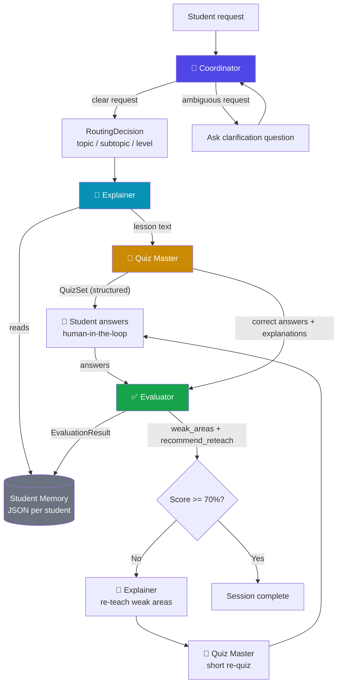

# Leo — Architecture Diagram

## Orchestration pattern

**Coordinator-led sequential pipeline with explicit typed hand-offs.**

- The four agents never run inside one giant automatic `Process.hierarchical`
  crew, because the pipeline must **pause for a real human** (the student
  answering the quiz) between the Quiz Master and the Evaluator stages.
- Instead, `leo/orchestrator.py`'s `LeoOrchestrator` runs each stage as its
  own single-task CrewAI `Crew` (`Process.sequential`) and passes each
  agent's **typed Pydantic output** as input context to the next stage:
  - Coordinator → `RoutingDecision` → Explainer
  - Explainer → lesson text → Quiz Master
  - Quiz Master → `QuizSet` → (student answers) → Evaluator
  - Evaluator → `EvaluationResult` → Student Memory
- The Coordinator still does real agentic work (parses free-text requests,
  decides topic/level, detects and resolves ambiguity) and the orchestrator
  plays the "manager" role for control flow — sequencing stages, retrying a
  stalled agent (`MAX_RETRIES` in `orchestrator.py`), and running the
  feedback loop back to the Explainer when the Evaluator recommends a
  re-teach.
